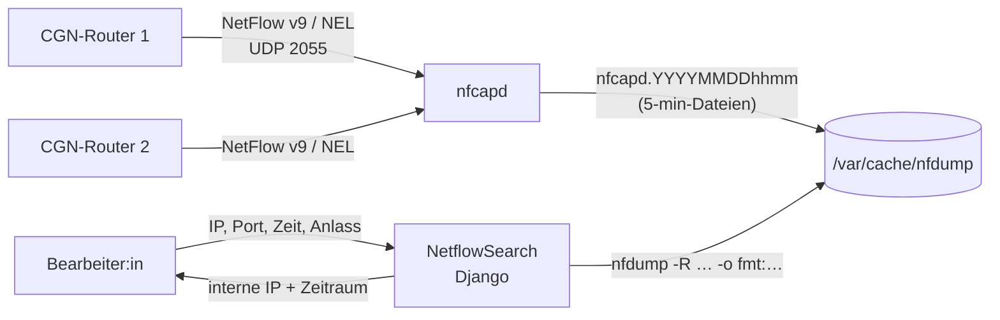

# NetflowSearch

Web-Frontend zur Beantwortung von Bestandsdatenanfragen in **CGNAT**-Umgebungen:
Wer nutzte zu einem bestimmten Zeitpunkt eine **öffentliche IP-Adresse** mit einem bestimmten **Port**?

Typischer Anwendungsfall sind Anfragen von Behörden (z. B. BSI) oder Abuse-Meldungen anderer Provider
im Format _„IP `203.0.113.17`, Port `51234`, 14.11.2026 13:45:12 UTC“_. NetflowSearch durchsucht die
NAT-Event-Logs (NetFlow v9 / NEL mit Port Block Allocation) der CGN-Router und liefert die zugehörige
interne CGNAT-Adresse (`100.64.0.0/10`) samt Zuweisungszeitraum.

> **Status:** Lern- und Lab-Projekt in aktiver Entwicklung. Die Testdaten sind **synthetisch**
> (öffentlicher Pool aus `TEST-NET-3` 203.0.113.0/24) und enthalten keine echten Kundendaten.

---

## Funktionsweise



Die CGN-Router vergeben pro Kunde **Port-Blöcke** (z. B. 1024 oder 2048 Ports, je Protokoll) und melden
jede Vergabe (`ADD`) und Freigabe (`DELETE`) als NAT-Event. Für eine Anfrage sucht NetflowSearch das
`ADD`-Event **vor** dem gesuchten Zeitpunkt, dessen Port-Block den Port enthält
(`pbstart ≤ port ≤ pbend`), und das passende `DELETE` **danach**. Daraus ergibt sich das Zeitfenster,
in dem die interne Adresse diese Ports nutzte.

| nfdump-Feld           | Bedeutung                                        |
| --------------------- | ------------------------------------------------ |
| `%sa`                 | interne CGNAT-Adresse des Kunden                 |
| `%xsa`                | öffentliche (übersetzte) Adresse                 |
| `%pbstart` / `%pbend` | zugewiesener Port-Block                          |
| `%nevt`               | NAT-Event: ADD (Vergabe) / DELETE (Freigabe)     |
| `%pr`                 | Protokoll (Blöcke werden pro Protokoll vergeben) |
| `%ra`                 | exportierender CGN-Router                        |

---

## Features

**Umgesetzt**

- Eigenes User-Model mit Login per E-Mail, eindeutig unabhängig von Groß-/Kleinschreibung
  (Manager, Model-Validierung und funktionaler DB-Index `LOWER(email)`)
- Registrierung mit Klarnamen-Pflicht, Domain-Whitelist und Django-Passwortrichtlinien (min. 12 Zeichen)
- Kontoaktivierung per E-Mail mit zustandslosem HMAC-Token (einmalig, 24 h gültig);
  Bestätigung per POST, damit Link-Scanner von Mail-Gateways keine Konten aktivieren
- Atomare Registrierung: schlägt der Mailversand fehl, wird kein Konto angelegt
- Session-Härtung: 8 h Lebensdauer, Ende beim Schließen des Browsers, Logout nur per POST
- Suchformular mit Validierung:
  - IP muss in einem konfigurierten NAT-Pool liegen
  - Port 1–65535, Protokoll TCP/UDP/ICMP/alle
  - Zeitangabe in MEZ/MESZ oder UTC, Erkennung nicht existierender und doppelter Uhrzeiten
    bei der Zeitumstellung
  - Zeitpunkt weder in der Zukunft noch außerhalb der Aufbewahrungsfrist
  - Pflichtfeld „Anlass / Aktenzeichen“
- Suche per POST, damit IP-Adressen nicht in URLs, Browserverlauf oder Proxy-Logs landen
- Eigenes CSS ohne Inline-Styles (Vorbereitung für eine strikte Content-Security-Policy)

**Geplant** – siehe [Roadmap](#roadmap)

---

## Tech-Stack

| Komponente    | Version                                              |
| ------------- | ---------------------------------------------------- |
| Python        | 3.13 (Debian 13) / 3.14 (Entwicklung unter Windows)  |
| Django        | 5.2 LTS                                              |
| nfdump        | 1.6.22 mit NSEL/NEL-Support                          |
| Datenbank     | SQLite (Lab), PostgreSQL (vorgesehen für Produktion) |
| Konfiguration | `python-dotenv`                                      |

---

## Installation (Entwicklung)

### Windows (PowerShell)

```powershell
git clone https://github.com/Ozinho78/NetflowSearch.git
cd NetflowSearch
py -3 -m venv .venv
.\.venv\Scripts\Activate.ps1
python -m pip install -r requirements.txt
```

### Linux

```bash
git clone https://github.com/Ozinho78/NetflowSearch.git
cd NetflowSearch
python3 -m venv .venv
source .venv/bin/activate
pip install -r requirements.txt
```

### Konfiguration

`.env` im Projektverzeichnis anlegen (neben `manage.py`). Einen Secret Key erzeugen mit:

```bash
python -c "from django.core.management.utils import get_random_secret_key as g; print(g())"
```

```ini
DJANGO_SECRET_KEY='…'
DJANGO_DEBUG=True
DJANGO_ALLOWED_HOSTS=127.0.0.1,localhost
SITE_URL=http://127.0.0.1:8000

# Registrierung
REGISTRATION_ALLOWED_DOMAINS=example.com

# Mail – ohne EMAIL_BACKEND werden Mails nur im Terminal ausgegeben
# EMAIL_BACKEND=django.core.mail.backends.smtp.EmailBackend
# EMAIL_HOST=smtp.example.com
# EMAIL_PORT=465
# EMAIL_USE_SSL=True
# EMAIL_USE_TLS=False
# EMAIL_HOST_USER=noreply@example.com
# EMAIL_HOST_PASSWORD='…'
# DEFAULT_FROM_EMAIL='NetflowSearch <noreply@example.com>'

# Suche
NAT_POOLS=203.0.113.0/24
SEARCH_MAX_AGE_DAYS=7
```

| Variable                       | Pflicht | Beschreibung                                                     |
| ------------------------------ | ------- | ---------------------------------------------------------------- |
| `DJANGO_SECRET_KEY`            | ja      | Signiert Sessions und Aktivierungs-Tokens. Niemals committen.    |
| `DJANGO_DEBUG`                 | nein    | `True` nur in der Entwicklung                                    |
| `DJANGO_ALLOWED_HOSTS`         | ja      | Kommagetrennte Hostnamen/IPs                                     |
| `SITE_URL`                     | ja      | Basis-URL für Links in Mails (bewusst nicht aus dem Host-Header) |
| `REGISTRATION_ALLOWED_DOMAINS` | nein    | Erlaubte Mail-Domains, leer = keine Einschränkung                |
| `EMAIL_*`                      | nein    | SMTP-Konfiguration; ohne Angabe Console-Backend                  |
| `NAT_POOLS`                    | ja      | Öffentliche CGN-Pools, kommagetrennt in CIDR-Notation            |
| `SEARCH_MAX_AGE_DAYS`          | nein    | Maximales Alter des Suchzeitpunkts, passend zur Aufbewahrung     |

### Starten

```bash
python manage.py migrate
python manage.py createsuperuser
python manage.py runserver
```

- Anwendung: <http://127.0.0.1:8000/>
- Admin: <http://127.0.0.1:8000/admin/>

---

## Projektstruktur

```
NetflowSearch/
├── accounts/            # User-Model, Registrierung, Aktivierung, Login
│   ├── emails.py        # Mailversand (Service-Schicht)
│   ├── tokens.py        # Aktivierungs-Token (HMAC)
│   └── templates/accounts/
├── search/              # Suchformular und (künftig) nfdump-Anbindung
│   └── templates/search/
├── config/              # Django-Projekt: settings, urls, wsgi
├── templates/           # globale Templates (base.html)
├── static/css/          # Stylesheets
├── manage.py
└── requirements.txt
```

---

## Roadmap

- [x] **Etappe 1** – Projekt-Setup, eigenes User-Model, Admin
- [x] **Etappe 2** – Login/Logout, Registrierung, Aktivierungsmail, SMTP
- [x] **Etappe 3** – Suchformular mit Validierung (Pool, Port, Zeitzone, Aufbewahrung)
- [ ] **Etappe 4** – nfdump-Anbindung: `subprocess.run()` mit Argumentliste und Timeout,
      Parsen der `fmt:`-Ausgabe, ADD/DELETE-Korrelation, Ergebnisanzeige
- [ ] **Etappe 5** – Audit-Log aller Abfragen (wer, wann, was, Anlass), Rollen und Berechtigungen
- [ ] **Etappe 6** – Deployment: gunicorn, nginx, systemd, eigener Service-User, `collectstatic`
- [ ] Registrierung ohne User-Enumeration, Passwort-Reset, Brute-Force-Schutz beim Login
- [ ] Content-Security-Policy und weitere Security-Header
- [ ] Automatisierte Tests

---

## Sicherheit und Datenschutz

Die Zuordnung öffentliche IP → interne Adresse ist ein **personenbezogenes Datum**.
Entsprechend gilt für den Betrieb:

- Zugriff nur für freigeschaltete Konten; jede Abfrage wird mit Anlass protokolliert (Etappe 5)
- Secrets ausschließlich über `.env` bzw. Umgebungsvariablen, nie im Repository
- Der Aufruf von `nfdump` erfolgt ohne Shell und nur mit validierten Parametern
- Die Aufbewahrung der Rohdaten wird außerhalb der Anwendung geregelt (z. B. `nfexpire`),
  `SEARCH_MAX_AGE_DAYS` muss dazu passen

---

## Lab-Umgebung

Entwickelt und getestet gegen einen Nachbau der Produktionsumgebung:

- Debian-13-LXC mit nfdump 1.6.22 (aus dem Quellcode, mit `--enable-nsel --enable-nel`)
- `nfcapd` als systemd-Dienst, 5-Minuten-Rotation
- Python-Generator, der zwei CGN-Router mit Port Block Allocation simuliert
  (ca. 1000 Kunden, Blockgrößen 1024/2048) und NAT-Events per NetFlow v9 exportiert
